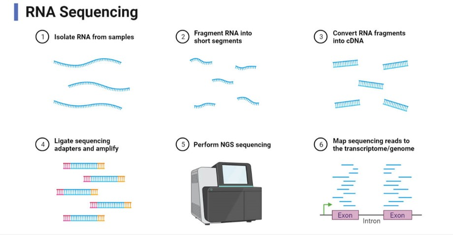
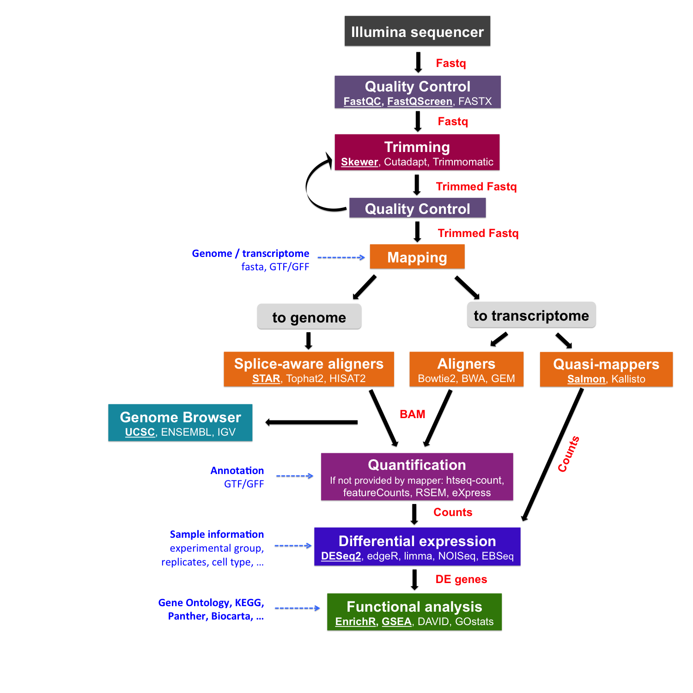
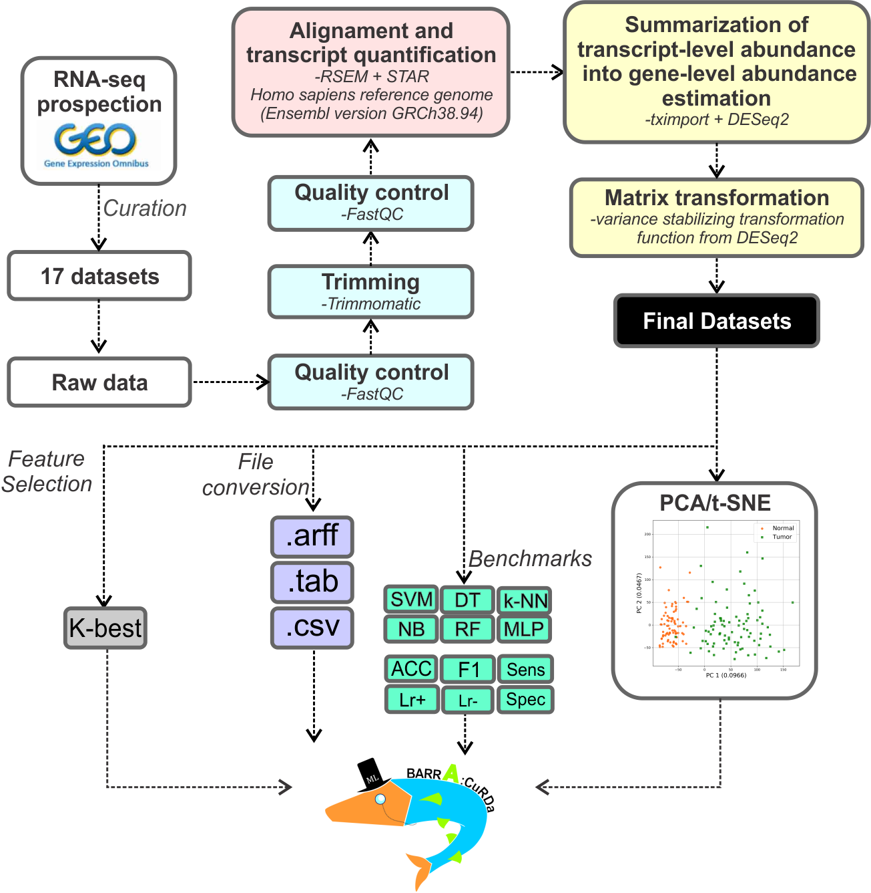
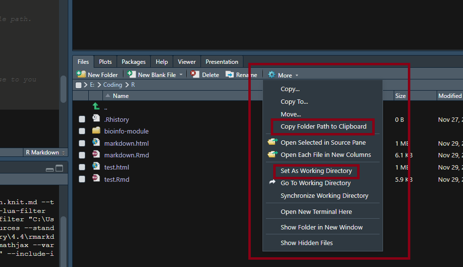
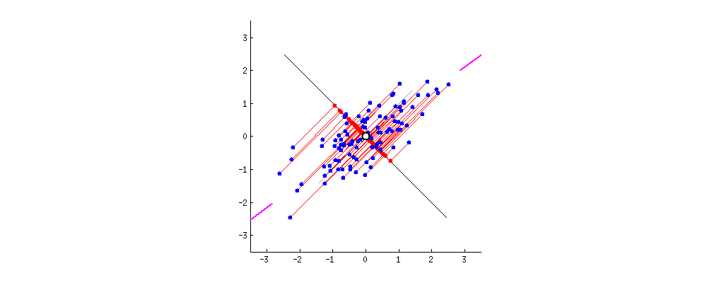
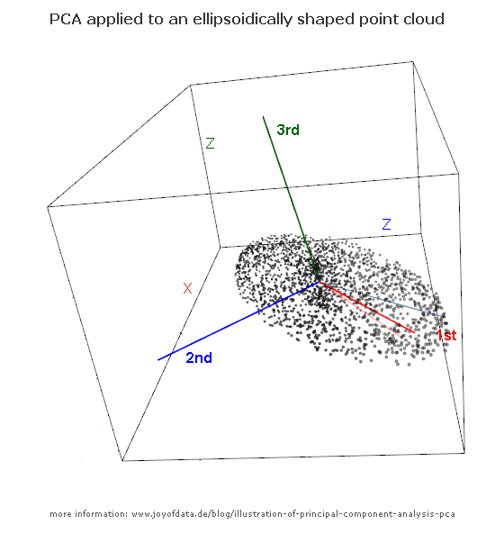

```{r setup, include=FALSE}
knitr::opts_chunk$set(echo = TRUE, message = FALSE, warning = TRUE,
                     fig.width = 8, fig.height = 4.8, dpi = 120,
                     fig.alt = "Plot generated by the adjacent R example.")
options(width = 90, dplyr.summarise.inform = FALSE)
source("check_setup.R")
library(tidyverse)
library(limma)
theme_set(theme_bw(base_size = 12))
```

# 00 / Establish contact

## The world you are entering

You live in a future where powerful companies control much of life beyond
Earth. Work is difficult, supplies are limited, and the company expects its
investment back. Read the introduction in whichever language you prefer.

### World introduction — English

<div class="world-image">


</div>

### Einführung in die Welt — Deutsch

<div class="world-image">


</div>

### Where the inspiration comes from

{width=420px}

The course draws inspiration from **ALIEN: The Roleplaying Game** and
**Chariot of the Gods**, by Andrew E. C. Gaska, published by Free League.


::: {.corporate-box}
**“A Recovery Mission Is Mandatory Under Corporate Policy”**

Mission priorities are as follows:

1. Recover all scientific data and biological samples from the USCSS Cronus.
2. Transport the Cronus to Anchorhead (Earth) or to another approved
   Weyland-Yutani facility.
3. Rescue surviving crew members of the Cronus.

Failure to comply with these priorities will be punished by forfeiture of
wages — at minimum.
:::

{width=280px}


<div class="transmission">
<div class="channel">WEYLAND-YUTANI // EMERGENCY REPEAT // SYNTHETIC AVA</div>
<p>This message is being repeated to all vessels within range.</p>
<p>The USCSS Cronus is stranded. I am heavily damaged. We require scientists
and medical personnel to investigate what happened aboard this vessel.</p>
<p>On arrival, your team will need to assess the thawing crew, recover the
ship's records, and examine any recovered material under company procedures.</p>
<p>Recovery compensation has been authorised by Weyland-Yutani.
Contract details will follow. Personnel accepting this assignment must
complete the attached scientific training before boarding.</p>
<p>I can still guide you through the analysis procedures.<br>
End of transmission.</p>
</div>

Sadly for you just being in this class counts as accepting the assignment. Welcome to the
recovery team!

AVA is a Synth on the Cronus, and she is your
fictional guide. You can use "AVA" (in reality every AI assistant that you like) to help you with the analysis of the data. It seems like everyone will be using AI to code in the future to begin with, so while you are obviously allowed to follow the "old script" (it is in the directory you downloaded as well), here it is specifically allowed and wanted to learn how to use AI to help you carry out a bioinformatics analysis. We are trying it like this for the first time, since getting people from no coding experience to doing meaningful analyses takes probably a two week workshop by itself. If you want, feel free to follow the old script, or spend your time on learning R basics in Exercise 0 and the material mentioned at the end of it. You are also allowed to skip it if you don't care, though (and overall we are not your parents, and you are here of your free will, so do whatever you think is right for you). A "rescue investigation" with some RPG elements then follows the training chapter.

Your training follows this sequence: **R basics → data import → PCA and
plotting → differential expression → batch correction → prediction →
single-cell outlook.** Prediction uses logistic regression. A single-cell
workshop on a real human brain dataset lets you practise identifying cell
populations before the mission.

The aim is to understand what the methods do, connect code into a working analysis using AI,
and analyze and judge the output. You do not need to memorise every command, and it is more realistic (nowadays) to produce results like that. Just make sure you keep your hands on the steering wheel :)

## Your route (roughly,...maybe)

| Training block | Main question | Aboard the Cronus | Suggested time |
|:--|:--|:--|--:|
| Contact, setup, and working with AI | How do we produce a result we can check? | Every finding must be checkable | 30 min |
| R basics | What is an object, a row, a column, a function? | Samples are labelled by crew member and timepoint | 35 min |
| Import and sample metadata | Which measurements belong to which sample? | Lab 2's records must stay with the right person | 35 min |
| PCA and plotting | What are the largest patterns? | Your first look at the crew data | 40 min |
| Differential expression | Which genes differ between Tumor and Normal? | Comparing affected and unaffected crew | 40 min |
| Batch correction, gene lists, and gene names | Which findings change after accounting for study, and what are the genes? | Three sequencing runs; company codenames for genes | 50 min |
| Prediction | Can a model generalise to another person? | Who stays free of infection after spore exposure? | 45 min |
| Debrief | What evidence can we carry into the mission? | Your boarding clearance | 15 min |
| Two breaks | | | 20 min |


Use the worked examples and ask for help when needed.
Each exercise ends with a **Done when** check, so you can test your own result.

If your code is stuck, the scripts in the `catch_up` folder recreate the objects
needed for the next step, so you can stay with the discussion. The second five-hour day starts with summarizing today's results and then moves to the
rescue investigation aboard the Cronus.

## R and RStudio: find your way around

Make sure that R and RStudio are available on the computer. **R** runs the
analysis; **RStudio** gives you an editor, console, file browser, plots, and help
in one place. Open the supplied **AVA_training.Rproj** file inside your
extracted course folder. This opens the project and sets its working directory.

Open **student_workbook.R**, or create a new script using **File → New File →
R Script**. Save it inside the project with a name you recognise. You can copy
worked examples from this tutorial and add your code for the exercises.
Run the current line or selected lines with **Ctrl+Enter**, or the **Run**
button. Use **Ctrl+S** to save the script as you go.

| RStudio area | What you use it for |
|:--|:--|
| Source/editor, usually top left | Write and save the script you will run again |
| Console, usually bottom left | Execute commands and read output, messages, and errors |
| Environment, usually top right | Inspect the objects currently held in memory |
| Files | Browse files and folders on your account |
| Plots | View figures produced by R |
| Help | Read documentation; put the cursor on a function and press F1 |

Pane positions can be changed in RStudio. The console is ready for a command
when it displays `>`. A `+` prompt usually means an expression is incomplete,
perhaps because a closing bracket or quotation mark is missing. Press **Esc**
to cancel that unfinished command, then check the complete line in your script.

::: {.teaching-box}
**Your script and your Environment**

The Environment contains objects from the current R session. Saving a script
preserves the commands used to create them. When you restart R, run those
commands again in order. A script that works only because an old object was
left in memory is difficult to reproduce. These projects open without restoring
an old workspace.
:::

## Before class: unpack the course on your university account

Use a persistent personal folder you can find again from another university
PC, for example **alien-lecture** inside your Documents folder. Download the
course and library archives and **fully extract** all of them into that one
folder before the session. Opening an HTML inside a ZIP does not extract the
data needed by R. Wait until extraction finishes.

Windows **Extract all** suggests a new folder named after each ZIP, such as
`AVA_training_students`. Change the destination to your course folder, so the
course folders end up side by side:

```text
alien-lecture/
  Rlib/                         # unpacked, compatible R packages
  AVA_training/
    AVA_training.Rproj
    AVA_training.html
    student_workbook.R
    data/
      bulk/
        GSE64912.csv
        GSE68799.csv
      ml/
        training_archive.csv
    output/
  single_cell_workshop/
    single_cell_workshop.Rproj
    single_cell_workshop.html
    data/
```

Open the project file in **AVA_training** to begin this chapter. The startup
check looks for **Rlib** inside the project, beside it, one folder further up,
and in `Documents/alien-lecture`. Rlib should directly contain package
directories such as `limma` and `Seurat`. If extraction produces an extra
enclosing folder, check the actual contents.

```{r check-installation, eval=FALSE}
source("check_setup.R")  # adds the supplied library location and checks the files
library(tidyverse)
library(limma)
.libPaths()             # folders R searches for installed packages
getwd()                 # current working directory for this project
```

Package installation should be complete before class. Please keep the tested
package versions; if an installer asks to update other packages, choose `n`.
If setup fails, tell the instructor and work with your neighbour while it is
resolved. You can help each other with code, interpretation, and AI prompts.

The [RStudio project guide](https://docs.posit.co/ide/user/ide/guide/code/projects.html)
explains how project files keep related work together.


## Working with an AI assistant

AI can help you write and explain R code, transform tables and whatnot, but its output still needs checking.

We use ordinary text questions. There is no requirement to upload files, buy a
subscription, or use a particular model. If your assistant is unavailable or
reaches its usage limit, the worked examples and the instructor can help you continue. You are also
encouraged to write the code yourself if that is what you want to practise.
We will discuss the concepts needed for the exam together.
Read the question and try a small step before asking for help.

For each task:

1. **Describe the question and the objects you actually have.** Include names,
   dimensions, the meaning of rows and columns, and a small example.
2. **Ask for one step.** Ask for an explanation and a check, not the whole mission.
3. **Read the code before running it.** Match input and output names to your script.
   **This is especially important for file paths:** a text-only chatbot sees the
   folder and object information you provide. Check every proposed path against
   your own project. Tools with file access may have more context.
4. **Run and inspect.** A finished command is not proof of a correct analysis.
5. **Save the working code and write your interpretation.**

> **An example prompt**
>
> I am learning R. My question is [question]. I have [object name and type].
> Its rows represent [meaning], its columns represent [meaning], and its
> dimensions are [numbers]. The relevant column names are [names].
> Use the packages already loaded: [packages]. Please give me only the next
> small step, explain each line, and add a check for the output. Do not invent
> data, file paths, sample labels, or biological conclusions.

If a command fails, paste the exact error together with the command and the
relevant object description. Ask why it failed before accepting a replacement
analysis. Keep the final working version in your script, not only in a chat.

<div class="checkpoint">
<strong>Before proceeding:</strong> locate your script, the console, the
Environment pane, and the Help pane. Explain the difference between seeing a
plot and having saved the code that produced it.
</div>

# 01 / Restore the analysis console

<div class="transmission">
<div class="channel">AVA // TRAINING CHANNEL 01 // LOCAL CONSOLE</div>
<p>Training starts. Check that you can read a small table.
A sample identifier connects a measurement to a record. On the Cronus, every
identifier names a crew member and a timepoint. If that connection is lost,
the analysis is unusable, even if the code still runs.</p>
</div>

We start with small R examples before working with the full archive.
Numbers here are invented practice values. The Normal/Tumor labels prepare us
for the real training archive in the next chapter.

```{r r_basics, eval=TRUE}
# Assignment with <-
# Think of "<-" as "gets"
x <- 5          # x gets and now represents the value 5
y <- 10
x + y           # 15

# Vectors: ordered lists of values
heights <- c(160, 172, 168, 181)   # numeric vector
groups  <- c("Normal", "Tumor", "Normal", "Tumor")  # character vector

# Square brackets select elements of a vector. R starts counting at 1.
heights[2]                 # second value
heights[c(1, 3)]           # first and third values
heights[heights > 170]     # values that satisfy a condition

heights
groups

# Data frames / tibbles: tables (rows = observations, columns = variables)
library(tidyverse)

samples <- tibble(
  ID     = c("sample1", "sample2", "sample3", "sample4"),
  class  = groups,
  height = heights
)

samples


```


### The pipe operator %>%

The pipe means:
"Take the thing on the left, and give it to the function on the right"

This lets us read code from left to right, like a sentence.

```{r r_basics2, eval=TRUE}
# without the pipe operator:
samples_filtered <- filter(samples, class == "Tumor")
samples_filtered <- dplyr::select(samples_filtered, ID, height)

samples_filtered

# with the pipe operator:
samples_filtered2 <- samples %>%
filter(class == "Tumor") %>% # keep only rows where class == "Tumor"
dplyr::select(ID, height) # keep only these columns

samples_filtered2

# Add a new column with mutate()

samples %>%
mutate(height_m = height / 100)   # convert cm → meters

# Group + summarise

samples %>%
group_by(class) %>%
summarise(mean_height = mean(height))

```

### Row names vs. columns

Expression data often stores sample IDs as row names (not as a column).
We’ll convert back and forth using `column_to_rownames()` and
`rownames_to_column()`.

```{r r_basics23, eval=TRUE}
toy <- tibble(
ID = c("sample1", "sample2"),
class = c("Normal", "Tumor"),
geneA = c(10, 50)
)

toy

# Convert ID column → row names

toy_df <- toy %>%
column_to_rownames("ID") %>%
as.data.frame()

toy_df

# Convert row names → ID column

toy_df %>%
rownames_to_column("ID")

```
### $ — Accessing a column by name

`$` is used to extract a column from a data frame or tibble.

Think: “inside this table, give me the column named ___”

```{r r_basics3, eval=TRUE}
samples <- tibble(
ID = c("sample1", "sample2", "sample3"),
class = c("Normal", "Tumor", "Normal"),
height = c(160, 172, 168)
)

samples$class # vector: "Normal" "Tumor" "Normal"
samples$height # vector: 160 172 168
```

### () — Calling a function

After a function name, parentheses contain its arguments. Parentheses can also group an expression.

```{r r_basics4, eval=TRUE}
mean(heights) # compute a mean
filter(samples, class == "Tumor") # filter rows
plot(1:10) # create a plot

```

### [] — Extract rows and columns

Square brackets are for subsetting.

For data frames and matrices: `object[rows, columns]`. Leaving one side
empty keeps all rows or all columns.

```{r r_basics5, eval=TRUE}
# Our samples tibble:
samples

samples[2:3, ] # rows 2 and 3

samples[, 1] # first column (ID)
samples[, 3] # third column (height)

samples[, "class"] # a one-column tibble; samples$class returns a vector
samples[1:2, "height"]

```
### Putting it together

The later PCA, differential expression, and prediction exercises build on these ideas:

- assign with `<-`
- the pipe `%>%`
- `select()`, `filter()`, and `mutate()`
- tibbles and data frames
- moving IDs between row names and a column

If a pipeline step confuses you later, you come back to this section and maybe it helps a little bit (: 

### Exercise 0: Read, predict, then run

When an assistant writes code for you, your job is to read it and check what it
produces. This exercise practises that, using the same steps you will need for
the real archive in Exercise 3. For each item, **write down what you expect
first**, then run the code and compare. A wrong prediction is useful: it shows
you which idea to look at again.

The table below is built like the real CSV files: one row per sample, a sample
ID, a class label, and one column per gene.

```{r ex0-mini, eval=FALSE}
mini <- tibble(
  ID    = c("sample1", "sample2", "sample3", "sample4"),
  class = c("Normal", "Tumor", "Normal", "Tumor"),
  gene1 = c(10, 50, 12, 48),
  gene2 = c(30, 31, 29, 33),
  gene3 = c(0, 5, 1, 9)
)
mini
```

**Predict, then run:**

1. `dim(mini)`: how many rows and columns? What does one row represent?
2. `mini$gene1`: do you get a table or a vector? How many values?
3. `mini[2, ]` and `mini[, 2]`: which one is a sample, and which one is a variable?
4. `mini %>% filter(class == "Tumor") %>% select(ID, gene1)`: which rows and
   columns remain?

Next, split `mini` the way Exercise 3 splits the real archive: sample information
in one object, numbers in another, linked by the sample IDs.

```{r ex0-split, eval=FALSE}
mini_meta <- mini %>%
  select(ID, class) %>%
  column_to_rownames("ID")

mini_expr <- mini %>%
  select(-class) %>%
  column_to_rownames("ID") %>%
  as.matrix() %>%
  t()
```

5. Before running: what will `dim(mini_expr)` and `rownames(mini_expr)` return?
   What did `t()` change?
6. `identical(colnames(mini_expr), rownames(mini_meta))`: what does `TRUE` tell
   you, and why does it matter?

**Check the assistant.** These two lines were suggested by an assistant:

```{r ex0-check, eval=FALSE}
mini_expr["gene1", c(2, 4)]          # gene1 values of the Tumor samples
mini %>% filter(Class == "Tumor")    # keep the Tumor samples
```

7. The first line returns the right numbers today. Why is it still risky?
   Rewrite it so it selects the samples by their class instead of their position.
8. Run the second line and read the error message. What is wrong?

**Write one line yourself:** keep the Normal samples of `mini`, and only the
columns `ID` and `gene3`.

**Talk with your neighbour:** What changes when you move sample IDs into row
names? How does this small table relate to an expression matrix with 67 samples
and 58,735 genes?

::: {.exercise-box}

**Done when:** you can say for each item whether your prediction was right,
and your own line returns 2 rows and 2 columns.

:::

#### More practice (optional)

If you are new to programming and want more hands-on practice, try these with
the `toy` and `mini` tables, or open the older course material supplied in the
**extra_practice** folder:

- Add a column `gene1_log2` to `mini` with `mutate()` and `log2()`.
- Use `group_by(class)` and `summarise()` to compute the mean of `gene1` per class.
- Turn `mini_meta` back into a tibble with an `ID` column, using `rownames_to_column()`.
- [Data analysis with R and the tidyverse](extra_practice/tidyverse_course.html):
  importing, tidying, transforming, and plotting, with exercises.
- [Practice datasets](extra_practice/tidyverse_practice_datasets.html): short
  analyses of built-in datasets such as `mtcars`, `CO2`, and the Titanic passengers.

Both older courses load some practice files from a university server, so they
need an internet connection. They use `spread()` and `gather()`; newer code and
AI assistants usually use `pivot_wider()` and `pivot_longer()` for the same job.

::: {.key-ideas}
**Key ideas · R basics**

- An object has a type and a shape. A vector holds values in one dimension; a
  data frame or matrix has rows and columns, selected with `[rows, columns]`.
- `$` extracts one named column as a vector; `[]` selects by position, by name,
  or by a condition.
- The pipe `%>%` hands the result on its left to the function on its right, so
  each step can be read and checked on its own.
- Sample IDs can live in a column or as row names. Selecting by ID keeps
  measurements attached to the right sample; selecting by position can silently
  pick the wrong one.
- `t()` swaps rows and columns: samples × genes becomes genes × samples.
:::


# 02 / Reconstruct the training archive

<div class="transmission">
<div class="channel">AVA // TRAINING CHANNEL 02 // HISTORICAL HUMAN ARCHIVE</div>
<p>This archive predates the Cronus incident. It holds tumour and normal
tissue from two studies of head and neck cancer. I chose it because the medical
records describe tissue growth in some of the crew that looks as uncontrolled
as a tumour. Keep the original labels attached. First establish what was
measured, in whom, and in which study. Lab 2 kept sequencing the crew
throughout the incident, and those records will need the same checks.</p>
</div>

## Introduction to RNA sequencing


Because of the ever-growing number of publicly available and large datasets in life sciences, computational and statistical skills are becoming a key part of the life scientist’s curriculum. This tutorial aims to give you an overview on how to load and convert data in R and how to do exploratory analysis, before downstream analysis of differential expression and gene-level patterns.

While microarrays are still in use and can be especially useful when interested in a specific set of genes (Custom Arrays), RNA-seq is the main source for expression data nowadays. Nevertheless, many techniques used for RNA-seq count data, in this course are directly - or with minor changes - applicable to microarray data too.

The basic workflow for RNA-seq and computational analysis can be seen in the figures below:
  
  

<small>*Figure 1: Rough scheme of a wet-lab workflow for RNA-seq. RNA is isolated from the source, fragmented and subsequently converted with the help of reverse transcriptase to cDNA. From here standard massively parallel sequencing techniques can be used: Adapters are added to the DNA strands, which are used internally in the sequencer and can differ depending on the sequencing chemistry used. The result will be provided in the form of a FASTQ file, that contains millions of short sequences, called reads, generated from sequenced library fragments. The color code shows to which steps the illustration on the right roughly belongs. Note that RNA extraction and selection are critical points in the process, that can alter the results significantly, by changing the input amounts and kind of RNA. Adapted from: https://microbenotes.com/rna-sequencing-principle-steps-types-uses/ *</small>
  
  
  

<small>*Figure 2: Quality control ensures, that the wet-lab experiments, worked as intended and can give the analyst insights on how to handle the data. If there are problematic samples, they can be removed to stop them from biasing the results, certain types of artifacts, namely batch effects, can also sometimes be detected during this phase and taken into account downstream. The subsequent mapping step holds much information about the quality of the data and should be considered if compute is not too demanding.
Trimming can remove adapters and low-quality sequence, potentially improving read alignment. It also removes sequence information, so its use should follow the quality assessment. For RNA-seq it is often not as important as for other functional genomics assays, though.
The mapping step is one of the most important in the pipeline. The reads saved in the FASTQ file are mapped, or aligned, to a reference genome. That means, an algorithm searches the whole genome for the best fit of the sequence of the given read. This step is computationally demanding as millions of reads need to be aligned to a sequence of millions of nucleotides. The resulting BAM files can be annotated and the reads that fall on the locus of a gene be counted, resulting in a gene count matrix. Our supplied files start further downstream: gene quantification and expression transformation were already performed.
Source: https://biocorecrg.github.io/RNAseq_course_2019/alignment.html *</small>
  
  
  
::: {.teaching-box}

  <strong>Automated Quality Control with ML:</strong> If you are interested in the quality control of FASTQ files, in RNA-seq as well as other functional genomics data, have a look at our work predicting sample quality with machine learning:
  Quality prediction:
  https://genomebiology.biomedcentral.com/articles/10.1186/s13059-021-02294-2
Batch effect detection with the same software:
  https://bmcbioinformatics.biomedcentral.com/articles/10.1186/s12859-022-04775-y

:::

  
## Overview
  
  The R language comes with many functions already working, such as arithmetic and logical operators, built-in functions like dim(), str(), min(), max(), mean() and much more. As a programming language it also features control structures like loops and allows you to write your own functions. It is an object-oriented language which allows to pack information from multiple sources into one object, which is often utilized as such by the bioinformatics packages and which we will also encounter.

### RLang, packages and libraries

The base language of R was meant for statistical programming and data visualization, but has been expanded by its community with packages for multiple scientific and programmatic purposes. Especially, for data science, machine learning and bioinformatics. Most packages that handle bioinformatics are available through BioConductor a project dedicated to building and maintaining bioinformatic software:
  
  The mission of the Bioconductor project is to develop, support, and disseminate free open source software that facilitates rigorous and reproducible analysis of data from current and emerging biological assays. We are dedicated to building a diverse, collaborative, and welcoming community of developers and data scientists.

The supplied package library should already be unpacked and checked before class. A package contains functions and data; a library is a folder holding installed packages. Load a package for the current R session by calling library().


## Import datasets and objects

### The BARRA:CuRDa dataset


To run any analysis, we first need our data of course. We’ll get our data from an already preprocessed and curated dataset source called BARRA:CuRDa - weird name I know - but we’ll not take the complete set but only choose some sets. The database, with its downloadable datasets and the paper can be found here: https://sbcb.inf.ufrgs.br/barracurda. The authors of the database and paper, have used the following workflow, you’ll notice some overlaps with what was discussed in the Introduction.



The dataset was picked and curated to be suitable for machine-learning research and benchmarked for multiple algorithms. With these data, we’ll focus on exploratory and differential analysis. The machine-learning part of the course uses a separate, small simulated archive to practise prediction. Its three features are simulated program scores, not genes from this archive.
We’ll start out with the Head and Neck Cancer datasets **GSE64912 and
GSE68799**. Both CSV files are supplied in **data/bulk**; there is no download
step during the exercise. The original source is
[BARRA:CuRDa](https://sbcb.inf.ufrgs.br/barracurda).

The supplied tables contain **67 samples: 59 Tumor and 8 Normal**, with
**58,735 gene columns**. SRR identifiers denote sequencing runs; they do not
automatically establish independent patient identities. ENSG identifiers
identify Ensembl genes.

::: {.teaching-box}
**What numbers are we analysing?**

These files contain transformed expression values. The previous course
describes DESeq2 variance-stabilising transformation (VST) in their preparation.
We retain the original files and that provenance note; the complete upstream
processing has not been independently reconstructed.

The cancer labels belong to the real training archive. Keep those labels
throughout the analysis. In the limma examples, the coefficient is a difference
on this supplied transformed scale, and should not automatically be interpreted
as an exact log2 fold change.
:::


## Importing data into R

To separate the content of each cell in a text file, people use characters
such as commas, tabs, or pipes. The extension is often a useful hint:
CSV usually means comma-separated values, while TSV usually means
tab-separated values. Inspect the file if its contents do not match that
expectation.

The first step in data import is locating the file on your computer or at a
remote location. The path tells a reading function which file to open. In this
course the data are supplied locally, inside your extracted project folder.

### Where are we?

Before actually importing the data, check your **working directory**. This is
the folder R uses as the starting point for relative paths. It may differ from
the folder you are currently browsing in the RStudio Files pane.

Open **AVA_training.Rproj** from the extracted folder. Then run:

```{r where-am-i, eval=FALSE}
getwd()
list.files()
file.exists("AVA_training.Rproj")
list.files(file.path("data", "bulk"))
```

You should see the project file, your script, and the `data` folder. Inside
`data/bulk` you should see the two CSV files. If you see another course folder
instead, you may be one level above the project.

::: {.teaching-box}
**Find the folder in Windows and in RStudio**

In Windows File Explorer, navigate to the extracted folder and click the
address bar to see its full location. **Copy as path** is also available from
the file/folder context menu on many university Windows setups.

In RStudio, the **Files** pane shows the folder you are browsing. Its **More**
menu can set that folder as the working directory. Browsing to a folder alone
does not change `getwd()`. Opening the supplied project is the simplest way to
start from the right place each time.
:::



An **absolute path** gives the full location, starting at a drive or network
location. A **relative path**, such as `data/bulk/GSE68799.csv`, starts at the
working directory. The same relative path can work for everyone even when
their university account folders have different names.

```{r path-examples, eval=FALSE}
# An example only: substitute the actual folder on YOUR account if needed.
# setwd("H:/YOUR_FOLDER/Bioinformatics_course/AVA_training")

# file.path() joins the pieces of a path using the appropriate separators.
input_file <- file.path("data", "bulk", "GSE68799.csv")
input_file
file.exists(input_file)

# Once the file exists, this shows its full location.
normalizePath(input_file, winslash = "/", mustWork = TRUE)

```

In an R string, use forward slashes (`H:/folder/file.csv`) or doubled
backslashes (`H:\\folder\\file.csv`). A copied path may include surrounding
quotation marks; keep exactly one pair around the path in R.

`setwd()` changes the working directory for the current session.
Avoid changing it midway through the
analysis, because every later relative path would then start somewhere else.

### Exercise 1: Set up input and output folders

You can create folders through Windows or RStudio, or use `dir.create()` in R.
The supplied project already contains both CSV files in `data/bulk`. Check
that they are there, and save new plots and result tables in `output`.

```{r folders, eval=FALSE}
out.dir <- "output"
in.dir <- file.path("data", "bulk")
dir.create(out.dir, showWarnings = FALSE)
stopifnot(dir.exists(in.dir))
list.files(in.dir, pattern = "\\.csv$")
stopifnot(all(file.exists(file.path(in.dir,
  c("GSE64912.csv", "GSE68799.csv")))))
```

::: {.teaching-box}
**If R says “cannot open file”**

Check `getwd()`, the result of `list.files(in.dir)`, the spelling of the
filename, and whether extraction has finished. A name typed in the Files pane
and a character string in your R script must refer to the same file.
Printing a path does not establish that the file exists; check `file.exists()`.
:::


## Exercise 2: Import and inspect

A CSV is a text table with comma-separated fields. `read_csv()` reads it into a
tibble. Start with one file, then read both. `map()` applies a function to each
file; `imap()` can also use each list element's name.

```{r import-one, eval=FALSE}
# Declare types to avoid guessing types for tens of thousands of gene columns.
archive_types <- cols(.default = col_double(),
                      ID = col_character(), class = col_character())
test <- read_csv(file.path(in.dir, "GSE68799.csv"),
                 col_types = archive_types, num_threads = 1)
dim(test)
test[1:4, 1:6]
```

```{r import-both, eval=FALSE}
csv_files <- c("GSE64912.csv", "GSE68799.csv")
data_list <- map(file.path(in.dir, csv_files),
                 ~ read_csv(.x, col_types = archive_types, num_threads = 1))
stopifnot(identical(names(data_list[[1]]), names(data_list[[2]])))
names(data_list) <- str_remove(csv_files, "\\.csv$")
data_list <- imap(data_list, ~ mutate(.x, dataset = .y))
combined_data <- bind_rows(data_list)
dim(combined_data)
combined_data %>% count(dataset, class)
```

Use `head()`, `dim()`, `str()`, and `summary()` on **small selections** of columns.
Printing all 58,738 columns is rarely helpful. Which columns describe the sample,
and which contain measurements? Why is the number of columns larger than the
number of genes? Inspect the start (head) and end (tail) of the combined data.

> **AI task:** Describe `combined_data` using its dimensions and its first six
> column names. Ask for code that checks whether sample IDs are unique and counts
> samples by study and class. Check the answer against the table above.

## Exercise 3: Separate metadata and expression

Make a sample information table and a numeric expression matrix.
**Keep one agreed orientation:** `expr` always means **genes × samples**.
`metadata_combined` has **samples × annotations**.
The same sample IDs must occur in the same order.

| Object | Rows | Columns |
|:--|:--|:--|
| `combined_data` | Samples | Sample annotations and gene measurements |
| `metadata_combined` | Samples | `class` and `dataset` |
| `expr` | Genes | Samples |
| `t(expr)` | Samples | Genes — the format needed by `prcomp()` |

Try `select()`, `column_to_rownames()`, `as.matrix()`, and `t()`.
Keep the names in the table above when accepting code from an assistant. 


::: {.exercise-box}

**Done when:** `dim(expr)` returns 58735 67, `dim(metadata_combined)` returns
67 2, `is.numeric(expr)` is `TRUE`, and
`identical(colnames(expr), rownames(metadata_combined))` is `TRUE`.

**Stuck for more than about ten minutes?** Run
`source("catch_up/after_exercise_3.R")`, read what it did, and continue with
Exercise 4.

:::


### What can go wrong: correct dimensions, wrong labels

Run this short demonstration after Exercise 3. It sorts the sample table
by class, which looks harmless.

```{r label-demo, eval=FALSE}
# The same sample table, sorted by class. Nothing looks wrong yet.
metadata_sorted <- metadata_combined[order(metadata_combined$class), ]
dim(metadata_sorted)                                   # still 67 rows, 2 columns
identical(colnames(expr), rownames(metadata_sorted))   # FALSE: the order changed
# Attaching the class labels by position now labels samples wrongly:
table(true_class = metadata_combined$class,
      attached_by_position = metadata_sorted$class)
```

The dimensions are still correct, and R gives no error. The table shows
how many samples now carry the wrong label. A PCA plot or a DE analysis with
these labels would run normally and give wrong results. `identical()` on
the IDs catches this; `dim()` does not.

## Exercise 4: Keep one study

Create `metadata_GSE64912` and `expr_GSE64912`. Repeat for GSE68799 if time allows.
Select expression columns **using sample IDs**, not a remembered column number.
This is the same skill you will use later to select people and timepoints.


::: {.exercise-box}

**Done when:** `expr_GSE64912` has 22 columns, `table(metadata_GSE64912$class)`
shows 4 Normal and 18 Tumor, and
`identical(colnames(expr_GSE64912), rownames(metadata_GSE64912))` is `TRUE`.
For GSE68799 you should find 45 samples: 4 Normal and 41 Tumor.

:::


<div class="checkpoint">
<strong>Class stop · Send Ava:</strong> the number of samples and genes, a statement about
what the values represent, and the result of your alignment check.
Explain what the sorting demonstration showed: why did the dimensions stay
correct while the labels went wrong?
</div>

::: {.key-ideas}
**Key ideas · The training archive**

- RNA-seq converts RNA into cDNA fragments, sequences them as reads, aligns the
  reads to a reference genome, and counts reads per gene. Our files start after
  these steps.
- The archive contains transformed expression values (DESeq2 VST according to the
  original course), not raw counts.
- An expression matrix is only usable together with its sample information.
  Here `expr` is genes × samples and `metadata_combined` is samples × annotations.
- Equal dimensions are not enough: sample IDs must match in identity and order.
  Select and join by ID, never by a remembered position.
- A relative path starts at the working directory. Opening the project sets it,
  so the same relative paths work on every account.
:::

Overall it starts to become important that you actually try to keep control of which data is stored how in which variable, and communicate that cleanly to your AI-assistant.

# 03 / Find the large patterns

<div class="transmission">
<div class="channel">AVA // TRAINING CHANNEL 03 // PATTERN REVIEW</div>
<p>Before examining individual genes, look at the archive as a whole.
Do samples resemble one another because of their biology, their study of
origin, or something we have not recorded? Your first look at the crew data
will be the same overview.</p>
</div>

## Exploratory analysis: foreword

Exploratory analysis is a critical first step in the interpretation of RNA-seq data, and when working with similar data organized in abundance/count/intensity matrices. This process is akin to an initial survey of the data landscape, aimed at understanding its basic characteristics, identifying potential outliers, and uncovering early patterns or trends. It can also include checking for batch effects, which are technical variations that can introduce unwanted noise into the data. In this respect it can also be used as the “last line” of quality control.

Visualization tools, such as heatmaps, box plots, and scatter plots, are commonly used in this stage to provide a graphical summary of the data. These can help researchers gain insights into the expression levels of different genes, the similarity between samples, and the overall structure of the data.

In summary, exploratory analysis of RNA-seq count data serves as a foundational step in the data analysis pipeline, setting the stage for more complex downstream analysis, such as differential expression analysis and pathway enrichment analysis. It can expose problems and guide downstream decisions. Further design and quality checks are needed to assess the reliability of conclusions.


### What is a PCA?

A Principal Component Analysis, short PCA, is a (linear) dimension reduction technique and therefore can be counted to classical unsupervised machine learning. It’s been around since 1901 and basically computes linear combinations that represent the variance in the data best. To do that, it starts with the longest axis in the data, by minimizing the sum of squared perpendicular distances of the points in the data to the first linear combination it computes: The first principal component (PC). This GIF gives a good intuition what's happening under the hood:


<small>*Figure 3: Minimization of distances to a line in 2D space.
The process is repeated incrementally, but every following PC must be orthogonal to all its predecessors, to ensure the PCs do not overlap in information about the underlying variance of the data. The image below shows three PCs fitted to an ellipsoid.*</small>



<small>*Figure 4: Three PCs fitted to an ellipsoid in 3D space, notice how the first PC is in parallel to the longest axis of the ellipsoid and the others are orthogonal to it and each other.

The thread I found these images in, is from crossvalidated, a sub-site of stackexchange, where one can often find answers to questions regarding statistics and machine learning. I recommend to check out the thread, it has a number of answers, ranging from very mathematical to much more intuitive explanations (as hopefully given above :D)
Link: https://stats.stackexchange.com/questions/2691/making-sense-of-principal-component-analysis-eigenvectors-eigenvalues *</small>

### And a Scatterplot?

A scatterplot is the most simple plot you can come up with, it plots two numerical variables against each other leading to a 2D point cloud. We’ll plot the first two principal components against each other, as we’ll see in a minute.

## Exercise 5: Principal component analysis

`prcomp()` expects observations in rows, so pass `t(expr)`.
Use `pca_obj$x` to obtain sample coordinates, convert sample row names into an
`ID` column, then join the metadata by `ID`.

> **AI task:** Ask for these steps using `expr` and `metadata_combined`.
> Require the returned plot table to contain one row per sample. Ask why
> joining by sample ID is preferable to attaching a column by position.


::: {.exercise-box}

**Done when:** your plot table has 67 rows, one per sample, with the columns
`PC1`, `PC2`, `class`, and `dataset`, and no missing `class` or `dataset` values.

:::


We centre each gene but do not scale every gene to unit variance. That choice
lets genes with more variation contribute more. There is no single PCA setting
that is automatically correct for every dataset.

## Exercise 6: Plot expression and PCA coordinates

In `ggplot()`, `aes()` maps columns to visual properties; layers are added with
`+`. The following example shows a density plot.
The x-axis contains transformed expression, not read counts.

```{r gene-density, fig.alt="Density of transformed expression for one gene, grouped by Normal and Tumor labels.", eval=FALSE}
plt <- ggplot(combined_data,
              aes(x = ENSG00000000003, fill = class, color = class)) +
  geom_density(alpha = 0.35) +
  labs(x = "Transformed expression: ENSG00000000003", y = "Density")
plt
```

Try changing `fill` to `dataset`. With only eight Normal samples, a smooth
density can suggest more certainty than the data support. Try `geom_point()`
or a boxplot with individual observations to see the actual measurements.

Now plot `PC1` against `PC2`, colour by `class` and shape by `dataset`.
Save the figure with `ggsave()`. Which grouping seems to track the largest
separation? What else would you need to know before calling it a technical effect?


::: {.exercise-box}

**Done when:** your PCA plot shows two colours (class) and two shapes (study),
and the PNG file appears in `output/`.

:::


**Study separation is a clue, not proof that every difference is technical.**
The studies can also differ in their participants and biology. A PCA plot alone
cannot untangle those possibilities.


::: {.teaching-box}

<strong>Batch effects and other artifacts: </strong>
Artifacts is a word for underlying factors that affect the data we are working with, but are not associated with the biological observation. By distorting the gene counts or introducing biases of other nature, they will impact the downstream analysis and lead to false results. The most abundant and impactful are the batch effects, which stem from technical differences in the experimental phase of an assay: Different handlers, reagents, machines are just a few sources for them. Sometimes they correlate well with differences in quality of a sample, as we showed in one of the works of the Automated Quality Control box. We’ll see how to handle them in later sections.

:::


## Exercise 7: How much variation do we see?

The PCA object contains standard deviations in `sdev`. Square them to obtain
variances, then divide by the sum across **all** components.
Make a scree plot of the first 20 components.


::: {.exercise-box}

**Done when:** the percentages for all components add up to 100, and the
scree plot shows 20 bars that get smaller from left to right.

:::


<div class="checkpoint">
<strong>Class stop · Send Ava:</strong> one saved PCA figure, the percentage explained by PC1,
and two possible explanations for the separation.
Do not equate "variance explained by PC1" with "variance caused by batch".
</div>

::: {.key-ideas}
**Key ideas · PCA and exploratory analysis**

- Exploratory analysis surveys the data before testing. It can reveal outliers,
  groups, and possible batch effects, and acts as a last line of quality control.
- PCA is an unsupervised, linear dimension reduction. PC1 follows the direction
  of largest variance; each later component is orthogonal to the previous ones
  and explains less.
- `prcomp()` needs samples in rows. Centring without scaling lets genes with more
  variation contribute more.
- The variance explained by PC1 describes the structure of the data. It does not
  tell you how much variance a batch causes.
- Separation by study is a clue, not hard proof of a technical effect/artifact: studies can
  also differ in their participants and biology.
:::

# 04 / Compare groups

<div class="transmission">
<div class="channel">AVA // TRAINING CHANNEL 04 // GROUP COMPARISON</div>
<p>A visible difference is a starting point. State the comparison, estimate
its size, and account for uncertainty. Test the archive labels first, and do
not rename them to match a story we have not established. Aboard, you will
compare crew members who were affected with those who were not. Their status
labels stay sealed until you are cleared.</p>
</div>

## Differential expression: background


Differential expression analysis is a key step in interpreting RNA-seq data, aiming to identify genes whose expression levels differ significantly between conditions. This process can reveal important insights into biological processes and diseases.

Raw RNA-seq counts have a mean-dependent variance and often show overdispersion relative to a Poisson model: the variance can exceed the mean. Counts are also affected by library size and may be small or zero. These features motivate suitable count models or transformations with precision weights. Variance exceeding the mean is not itself a violated assumption of a t-test; applying ordinary tests directly to raw counts ignores other important features of their measurement process.

The figure below uses **simulated counts**, not our archive: 2,000 genes
with six replicates each. For Poisson counts the variance follows the dashed
line, variance = mean. Real replicates also differ biologically, so their
counts behave more like the negative binomial panel: the points lie above the
line, increasingly so for highly expressed genes. That extra spread is the
overdispersion.

```{r overdispersion, echo=FALSE, fig.width=9, fig.height=4, fig.alt="Mean against variance for simulated Poisson and negative binomial counts on log axes; the negative binomial genes lie above the variance-equals-mean line."}
set.seed(1)
mu <- 10^runif(2000, 0, 3.5)          # 2,000 simulated genes, mean 1 to ~3,000 reads
counts <- list(
  "Poisson: variance = mean" = matrix(rpois(2000 * 6, mu), ncol = 6),
  "Negative binomial: extra biological variation" =
    matrix(rnbinom(2000 * 6, mu = mu, size = 10), ncol = 6))
mean_variance <- imap_dfr(counts, ~ tibble(Model = .y, Mean = rowMeans(.x),
                                           Variance = apply(.x, 1, var)))
ggplot(filter(mean_variance, Mean > 0, Variance > 0), aes(Mean, Variance)) +
  geom_point(alpha = 0.25, size = 0.7, colour = "#087e83") +
  geom_abline(intercept = 0, slope = 1, linetype = 2) +
  scale_x_log10() + scale_y_log10() +
  facet_wrap(~ Model) +
  labs(title = "Simulated counts, six replicates per gene",
       subtitle = "Dashed line: variance = mean")
```

To address these challenges, specialized statistical methods and tools have been developed for differential expression analysis of RNA-seq data, such as DESeq2, edgeR, and limma-voom. These methods account for the overdispersion and count-based nature of RNA-seq data, providing more accurate and reliable results.

The process typically involves data normalization, dispersion estimation, and hypothesis testing. The result is a list of genes ranked by significance, along with statistics such as fold change and false discovery rate (FDR).

In summary, differential expression analysis is a powerful tool for identifying genes that are differentially expressed between conditions, providing valuable insights into the underlying biology. However, it’s important to use appropriate statistical methods and tools that account for the unique characteristics of RNA-seq data.

### Limma

Limma (Linear Models for Microarray Data) is a widely used R package for the analysis of gene expression data, including both microarray and RNA-seq data. Limma was originally developed for the analysis of microarray data, but has since been adapted for the analysis of RNA-seq data using the voom transformation.

The voom (variance modeling at the observation level) transformation is used to transform RNA-seq count data into a format that can be analyzed using linear models. The voom transformation estimates the mean-variance relationship of the count data and generates a set of weights that are used to account for the variability in the data. These weights are then used in the linear modeling step to improve the accuracy and power of the analysis. Our supplied archive is already transformed, so this teaching analysis uses lmFit() on those values. VST and voom are different procedures: VST does not provide voom's observation-level precision weights. A full raw-count workflow would require its own filtering, normalisation, and model assessment.

Limma uses linear models to test for differential expression between conditions, while accounting for various sources of variability, such as batch effects and other covariates. The linear models include design matrices that specify the experimental design and allow for estimation of condition differences while accounting for the included covariates. For our supplied transformed data, interpret the coefficient on that transformed scale.

One of the key features of limma is its empirical Bayes method for estimating gene-wise variances. This method borrows information across genes to improve the stability and accuracy of the variance estimates, especially when the number of biological replicates is limited.

Reference: Ritchie ME, Phipson B, Wu D, Hu Y, Law CW, Shi W, Smyth GK (2015). “limma powers differential expression analyses for RNA-sequencing and microarray studies.” Nucleic Acids Research, 43(7), e47. doi:10.1093/nar/gkv007.


## Exercise 8: Differential expression with limma

Differential expression asks which genes differ between specified conditions.
For each gene we fit a model, estimate a difference, and assess uncertainty.
With many genes, unadjusted p-values would create many false leads.

**limma** fits linear models and shares information across genes to stabilise
variance estimates. Here we use the supplied transformed archive for an
**exploratory teaching comparison**. The column that limma calls `logFC` is
therefore a difference on the transformed scale, as explained in *What numbers
are we analysing?* in chapter 02.

Start with Tumor minus Normal, temporarily ignoring study. We will improve that
model in the next chapter.

The design formula needs a factor column called `Condition`. Create it from
`class` with Normal as the reference level, so the coefficient estimates Tumor
minus Normal. Exercise 9 reuses this column, so keep the name.

```{r condition-factor, eval=FALSE}
metadata_combined$Condition <- factor(metadata_combined$class,
                                     levels = c("Normal", "Tumor"))
table(metadata_combined$Condition, useNA = "ifany")
```

> **AI task:** I have `expr`, a numeric genes-by-samples matrix of already
> transformed expression, and `metadata_combined` with matching sample row names
> and a factor column `Condition` with levels Normal and Tumor. Using limma, fit
> `~ Condition` with Normal as the reference and return all genes with
> Benjamini–Hochberg adjusted p-values. Include a sample alignment check.
> Explain the direction and scale of the coefficient. Do not apply voom to
> these transformed values.


::: {.exercise-box}

**Done when:** `de_unadjusted` has 58,735 rows with gene IDs as row names and
columns including `logFC`, `t`, `P.Value`, and `adj.P.Val`. Check the sign for
one gene yourself: in this two-group model, `logFC` equals the mean in Tumor
minus the mean in Normal.

:::


The object name `de_unadjusted` means **unadjusted for batch**. Its `adj.P.Val`
column already contains multiple-testing-adjusted p-values.

For this exercise only, highlight genes with `adj.P.Val < 0.05` and an absolute
transformed-scale difference above 1. That magnitude is a teaching threshold,
not a universal biological rule.

```{r volcano, fig.alt="Volcano plot of transformed expression differences and adjusted p-values before study adjustment.", eval=FALSE}
volcano_data <- de_unadjusted %>%
  rownames_to_column("gene_id") %>%
  mutate(highlight = adj.P.Val < 0.05 & abs(logFC) > 1)
ggplot(volcano_data, aes(logFC, -log10(pmax(adj.P.Val, 1e-300)),
                        color = highlight)) +
  geom_point(alpha = 0.45, size = 0.8) +
  scale_color_manual(values = c("FALSE" = "#a4b4b8", "TRUE" = "#087e83")) +
  labs(x = "Tumor − Normal: difference in transformed expression",
       y = "−log10 adjusted p-value", title = "Exploratory comparison")
```

::: {.teaching-box}

<strong>P-Values: </strong>
The p-value is a statistical measure that helps determine the significance of a hypothesis test. In the context of a moderated t-test, such as the one used in the limma package in R, the p-value represents the probability of observing the test statistic (or a more extreme value) assuming the null hypothesis is true. The null hypothesis typically states that there is no difference between the groups being compared.

The calculation of the p-value in a moderated t-test involves first computing the moderated t-statistic, which takes into account both the observed differences between the groups and the associated uncertainties. This moderated t-statistic is then compared to a t-distribution with appropriate degrees of freedom to obtain the p-value. The degrees of freedom are calculated based on the number of samples and the estimates of gene-wise variances. The p-value obtained from this process indicates the level of evidence against the null hypothesis, with smaller p-values suggesting stronger evidence in favor of the alternative hypothesis (i.e., there is a significant difference between the groups).

:::


A p-value is not the probability that a gene is "real" or that the null
hypothesis is true. FDR adjustment addresses the expected proportion of false
discoveries among a set of findings under the method's assumptions.
Effect size and uncertainty answer different questions.

<div class="checkpoint">
<strong>Send Ava:</strong>
(1) Pick one gene with a positive `logFC` in `de_unadjusted`. Is it higher in
Tumor or in Normal? Check with its mean in each group.
(2) Suppose no gene truly differed between Tumor and Normal. With 58,735 tests at
p &lt; 0.05, about how many genes would still look significant by chance? How many
genes have `P.Value < 0.05`, and how many have `adj.P.Val < 0.05`?
</div>

::: {.key-ideas}
**Key ideas · Differential expression**

- DE fits a model for every gene and tests a named comparison. Here it is
  Tumor − Normal, so a positive coefficient means higher expression in Tumor.
- limma's empirical Bayes step borrows information across genes to stabilise
  variance estimates when there are few replicates.
- With tens of thousands of tests, many small p-values arise by chance.
  Benjamini–Hochberg adjustment controls the expected proportion of false
  discoveries among the genes called significant.
- A p-value is not the probability that a gene is "real". Effect size and
  uncertainty answer different questions.
- On these transformed values, the coefficient is a difference on that scale,
  not automatically a log2 fold change.
:::

# 05 / Separate biology from recording conditions

<div class="transmission">
<div class="channel">AVA // TRAINING CHANNEL 05 // RECORDING CONDITIONS</div>
<p>The archive combines two studies. A recording process can leave a signature
of its own. Account for the study while preserving the comparison you intended
to make. The crew samples were sequenced in three separate runs.
Keep the original measurements so we can revisit your decisions.</p>
</div>

::: {.teaching-box}
**Two uses of batch information**

For differential expression, fit the original `expr` with
`~ Condition + Batch`. The design accounts for study in the Tumor-minus-Normal
comparison and its uncertainty.

For an exploratory PCA figure, `removeBatchEffect()` produces an adjusted
matrix while preserving the terms supplied in `design`. We keep that matrix
under the separate name `expr_corrected`. It is used for the figure only.

See the [limma documentation](https://rdrr.io/bioc/limma/man/removeBatchEffect.html).
:::

## Exercise 9: Batch-aware analysis

Batch effects can arise from different preparation dates, reagents, instruments,
or processing. Here `dataset` is a recorded study label that we use as a batch
covariate. First check whether both biological groups occur in each study.

```{r batch-design, eval=FALSE}
metadata_combined$Batch <- factor(metadata_combined$dataset)
with(metadata_combined, table(Batch, Condition))
design_batch <- model.matrix(~ Condition + Batch, data = metadata_combined)
stopifnot(!anyNA(metadata_combined$Batch),
          identical(rownames(design_batch), colnames(expr)),
          qr(design_batch)$rank == ncol(design_batch))
```

If all Normal samples came from one study and all Tumor samples from the other,
study and condition would be completely confounded. Software could not recover
their separate effects from that design. Our table contains both classes in each
study, but is imbalanced and still cannot account for every unrecorded difference.

> **AI task:** Extend the previous limma model to include `Batch` while testing
> the same `ConditionTumor` coefficient. Keep the original expression matrix.
> Explain the difference between adjusting the statistical model and making a
> corrected matrix for a figure.


::: {.exercise-box}

**Done when:** `de_batch` has 58,735 rows, your Batch × Condition table shows
4 Normal and 18 Tumor in GSE64912 and 4 Normal and 41 Tumor in GSE68799, and you
have counted the highlighted genes with and without the study term.

**Stuck?** `source("catch_up/after_exercise_9.R")` recreates `de_unadjusted`,
`de_batch`, and the `Condition` and `Batch` columns, so you can continue with
the comparisons below.

:::


## Exercise 9b: Two volcano plots, with and without the study term

Keep Tumor minus Normal as the comparison in both panels. The left panel is the
pooled model from Exercise 8, the right panel the model with the study term from
Exercise 9. Both use the same genes, axes, and highlighting thresholds.

The code below is supplied: here the skill is reading the comparison, not
writing the plotting code. It uses `de_unadjusted` and `de_batch`.

::: {.exercise-box}

**Before you run it:** write down which panel you expect to have more highlighted
genes, and why.
**Done when:** you have compared your prediction with the two panels and the
figure is saved in `output/`.

:::

```{r volcano-comparison, eval=FALSE}
comparisons <- list("Pooled: no study term" = de_unadjusted,
                    "Pooled: with study term" = de_batch)
volcano_comparison <- imap_dfr(comparisons, function(d, label) {
  rownames_to_column(d, "gene_id") %>%
    mutate(Comparison = label,
           Highlight = adj.P.Val < 0.05 & abs(logFC) > 1)
})
volcano_comparison$Comparison <- factor(volcano_comparison$Comparison,
                                        levels = names(comparisons))
volcano_comparison %>% group_by(Comparison) %>%
  summarise(Highlighted_genes = sum(Highlight))
volcano_panels <- ggplot(volcano_comparison,
    aes(logFC, -log10(pmax(adj.P.Val, 1e-300)), colour = Highlight)) +
  geom_point(alpha = 0.4, size = 0.6) +
  geom_vline(xintercept = c(-1, 1), linetype = 3, colour = "grey60") +
  geom_hline(yintercept = -log10(0.05), linetype = 3, colour = "grey60") +
  scale_colour_manual(values = c("FALSE" = "#a4b4b8", "TRUE" = "#087e83")) +
  facet_wrap(~ Comparison, ncol = 2) +
  labs(x = "Tumor - Normal: difference in transformed expression",
       y = "-log10 adjusted p-value")
volcano_panels
ggsave(file.path(out.dir, "volcano_comparisons.png"), volcano_panels,
       width = 10, height = 4.5)
```

Describe what changed on each axis between the two panels. Both panels use the
same samples, so the difference comes from the modelling choice alone. Does the
study term only remove findings, or does it also add some?

## Exercise 9c: Put names to the genes

Ensembl IDs identify genes precisely, but they do not tell us what a gene does.
Company files aboard the Cronus use their own codenames for genes, so matching
a gene to a name and a function will matter there as well.
`data/annotation/gene_annotation.csv` lists every gene ID of the archive with
its gene symbol, a short description, and its biotype, such as protein-coding
or long non-coding RNA. The table was built in advance from Bioconductor
annotation packages, so there is no online lookup during class.

1. Read the table and join it to `de_batch` by gene ID. How many of the 58,735
   IDs have a symbol? Which biotypes are most common?
2. Look at the 20 genes at the top of the joined table, sorted by absolute `t`.
   Pick one gene that has a symbol.
3. Plot its expression in every sample, by class and study. The plotting code
   is supplied; change the gene ID to your choice.

```{r gene-names, eval=FALSE}
annotation <- read_csv(file.path("data", "annotation", "gene_annotation.csv"),
                       show_col_types = FALSE)
de_named <- de_batch %>%
  rownames_to_column("gene_id") %>%
  left_join(annotation, by = "gene_id")
stopifnot(nrow(de_named) == nrow(de_batch))
de_named %>%
  arrange(desc(abs(t))) %>%
  select(gene_id, symbol, biotype, logFC, adj.P.Val) %>%
  head(20)
```

```{r gene-plot, eval=FALSE}
gene <- "ENSG00000110092"   # CCND1 as an example; use the ID of your chosen gene
gene_plot <- metadata_combined %>%
  rownames_to_column("ID") %>%
  mutate(expression = expr[gene, ID]) %>%
  ggplot(aes(class, expression, colour = dataset)) +
  geom_boxplot(aes(group = class), outlier.shape = NA, colour = "grey55") +
  geom_point(position = position_jitter(width = 0.15, height = 0, seed = 42),
             size = 2, alpha = 0.8) +
  labs(x = NULL, y = "Transformed expression", title = gene)
gene_plot
ggsave(file.path(out.dir, paste0("gene_", gene, ".png")), gene_plot,
       width = 6, height = 4)
```

> **AI task:** Ask your assistant what the gene you picked is known for, in two
> or three sentences, and whether it has been linked to head-and-neck cancer.
> Then check the answer in [NCBI Gene](https://www.ncbi.nlm.nih.gov/gene/) by
> searching for the symbol together with "human". Note one statement the
> database supports and anything you could not confirm there.

More than a third of the IDs have no symbol. Many are non-coding RNAs,
pseudogenes, or poorly characterised genes, so a top-ranked ID without a name
is not an error. A gene's known function can make a result plausible or
surprising. It does not show that this gene causes the difference between the
Tumor and Normal samples here.

**Look at your plot:** does your gene separate every Tumor sample from every
Normal sample, or do the two groups overlap? If you had to classify the next
person from this gene alone, how often would you be wrong? A gene can differ
clearly on average and still be a poor predictor for an individual.

::: {.exercise-box}

**Done when:** your joined table still has 58,735 rows, your plot shows all 67
samples, and you have written down what the database says and whether the
assistant agreed.

:::

## Exercise 9d: How do you pick the top genes?

A top-20 list depends on two choices: the model (with or without the study
term) and how you rank the genes. Two common rankings:

- **Largest difference, |logFC|:** genes whose group means differ most between
  Tumor and Normal.
- **Strongest evidence, |t|:** the moderated t-statistic divides the difference
  by its uncertainty. It favours differences that are consistent across
  samples, even when they are smaller.

Now that the genes have names, keep only **protein-coding genes with a symbol**
and genes with `adj.P.Val < 0.05`. Then build four lists of 20 genes: each
ranking, for each model.

> **AI task:** I have two limma result tables, `de_unadjusted` and `de_batch`,
> with gene IDs as row names and the columns `logFC`, `t`, and `adj.P.Val`, and a
> table `annotation` with the columns `gene_id`, `symbol`, and `biotype`. Keep genes
> with biotype "protein_coding", a symbol, and adj.P.Val < 0.05. For each result
> table, take the 20 genes with the largest absolute logFC and, separately, the
> 20 with the largest absolute t. Show how many genes each pair of lists shares,
> and list the genes that are not on all four lists.

::: {.exercise-box}

**Done when:** you have four lists of 20 different protein-coding genes, a table
of how many genes each pair of lists shares, and the genes that are on only
some of the lists, with their logFC and t.

:::

**Discuss with your neighbour:**

- Which choice changes the list more: the study term or the ranking?
- Pick a gene that is only on a logFC list and plot it with the code from
  Exercise 9c. Why is its t-statistic not among the largest?
- Which list would you give a lab colleague who can test five genes in a
  follow-up experiment? Which would you use to look for a marker that should
  work for the next patient?

Neither ranking is simply right. With only eight Normal samples, the largest
differences often come from genes that are almost switched off in one group, or
from a few extreme samples. A large t needs a difference that is consistent
across samples. Many analyses therefore combine both: a significance cut-off, a
minimum difference, then a ranking.

## Visualise the adjustment

For a PCA figure, `removeBatchEffect()` can subtract the estimated study
component while retaining the condition terms specified in the design.
We use the **same genes and PCA settings** before and after adjustment.
Differential expression above used the original matrix and a batch-aware model.

The code below is supplied. Read it before running: which object is the
corrected matrix, and which design tells `removeBatchEffect()` what to keep?

```{r batch-pca, eval=FALSE}
expr_corrected <- removeBatchEffect(
  expr, batch = metadata_combined$Batch,
  design = model.matrix(~ Condition, data = metadata_combined))
pca_table <- function(m) {
  prcomp(t(m), center = TRUE, scale. = FALSE)$x %>%
    as_tibble(rownames = "ID") %>%
    left_join(rownames_to_column(metadata_combined, "ID"), by = "ID")
}
compare_pca <- bind_rows(
  mutate(pca_table(expr), Stage = "Before adjustment"),
  mutate(pca_table(expr_corrected), Stage = "After adjustment"))
compare_pca$Stage <- factor(compare_pca$Stage,
                            levels = c("Before adjustment", "After adjustment"))
batch_plot <- ggplot(compare_pca, aes(PC1, PC2, color = class, shape = dataset)) +
  geom_point(size = 2.4, alpha = 0.85) +
  facet_wrap(~ Stage, scales = "free") +
  labs(title = "Same genes; PCA recomputed at each stage")
batch_plot
ggsave(file.path(out.dir, "pca_batch_comparison.png"), batch_plot,
       width = 9, height = 5)
stopifnot(identical(dim(expr), dim(expr_corrected)),
          identical(dimnames(expr), dimnames(expr_corrected)))
```

::: {.exercise-box}

**Done when:** the before/after figure is saved in `output/`, and you can say
what changed between the two panels and what stayed the same.

:::


The panels have separately fitted axes; their directions and scales need not
match. We explicitly preserve the known condition in this correction, so
remaining separation by class is not an independent validation of that class.
For a future prediction task, preprocessing must be fitted without using the
held-out outcomes. Do not use this outcome-informed corrected matrix as a
shortcut to evaluating prediction.

Other methods you may encounter are **ComBat** for recorded batches and **SVA**
for estimating hidden variation. They are
background here rather than additional compulsory workflows: neither can
guarantee that removed variation was purely technical.

<div class="checkpoint">
<strong>Class stop · Send Ava:</strong> the before/after figure, your sample-by-group table,
and two sentences explaining what the adjustment assumes. Would "the groups now
look clearer" be sufficient evidence that the analysis is correct?
</div>

::: {.key-ideas}
**Key ideas · Batch effects and gene lists**

- Batch effects are technical differences between groups of samples, for example
  from handling, reagents, machines, or separate studies. They can distort results.
- For testing, add batch to the model (`~ Condition + Batch`) and keep the
  original data.
- A corrected matrix from `removeBatchEffect()` is for figures. It was made using
  the known conditions, so it cannot validate them and must not be used to
  evaluate a prediction.
- If every Normal sample came from one study and every Tumor sample from the
  other, no method could separate study from condition.
- A clearer PCA after correction is not proof that the correction was right.
- A top-gene list depends on the model and on the ranking: |logFC| favours
  large differences, |t| favours consistent ones. A gene symbol makes a result
  interpretable; it does not explain its cause.
:::

# 06 / Predict an unseen outcome

<div class="transmission">
<div class="channel">AVA // TRAINING CHANNEL 06 // LV-1113 EXPOSURE MODEL</div>
<p>Group comparisons describe differences in the archive. The next task is
different: use measurements taken before an outcome to predict that outcome in
people the model has not seen. This archive is Weyland-Yutani's model of a
spore exposure on LV-1113, with 300 simulated colonists in three settlements.
Twelve blood programs were measured before exposure; the company has not
released what they measure. Afterwards, some people stayed free of infection;
most did not. Set the test records aside before fitting the model. Report the
mistakes as well as the successes.</p>
</div>

## What changes with machine learning?

| Method | Question | What its output does not establish |
|:--|:--|:--|
| Differential expression | Which genes differ between specified groups? | Reliable prediction for a new person |
| Logistic regression | How do features relate to the probability of a binary outcome? | A causal mechanism |
| Random forest | Can collections of decision trees capture predictive patterns? | That an important feature is a causal pathway |
| Pathway analysis | Do signals concentrate in a defined gene set? | That the pathway causes the outcome |

These methods can inform the same investigation, but answer different questions.
**Logistic regression is our one required prediction model.** It models the
(log-)odds of an outcome; converting these to a probability gives a number between
zero and one. A random forest is an optional discussion

## A simulated exposure archive

`data/ml/training_archive.csv` contains **300 independent simulated people**.
Each row is one person, measured once. It is separate from the cancer data. `data/ml/feature_dictionary.csv` describes every column,
including when it was measured.

| Column | Meaning |
|:--|:--|
| `person_id` | Simulated colonist; never a predictive feature |
| `split` | Fixed allocation: 200 training people, 100 test people |
| `settlement` | North, South, or Refinery, at the time of the release |
| `M01` … `M12` | Twelve simulated blood-program activity scores, measured before exposure |
| `antibody_titre_day14` | Antibody level in blood, measured 14 days after exposure |
| `infection_free` | Outcome: 1 = stayed free of infection; 0 = infected |

These are supplied summary scores, **not raw RNA-seq counts or newly discovered
pathways**. In real work, gene sets and their scoring method ould have to be defined or
learned without looking at the test outcomes. This archive lets us more easily study
prediction without also teaching genome-wide feature selection.

## Exercise 10: Fit a first model

Read the archive. Check unique people, missing values, outcome counts, and the
split. How many people stayed free of infection? Start with the three programs
the company lists first: use only `M01`, `M02`, and `M03` to predict
`infection_free`. Keep the test people aside.

Again, you can try yourself at getting a result from prompting an AI just with the information you have. Or use the prepared one of course :P (why d we need a test and a train set? what is a regression  in the first place? Iss this already working like an AI or different?)

> **AI task:** I have `archive` with one row per independent person and the columns
> `person_id`, `split`, `settlement`, `M01` to `M12`, `antibody_titre_day14`, and
> binary `infection_free`. Use base R `glm(..., family = binomial())` on rows where
> `split == "train"`, with only `M01`, `M02`, and `M03` as features. Predict
> probabilities on rows where `split == "test"` using `type = "response"`.
> Include checks that the people do not overlap and the probabilities lie in [0,1].

::: {.exercise-box}

**Done when:** your training table has 200 people and your test table 100, no
person appears in both, the model converged, and all test probabilities lie
between 0 and 1.

:::

These score units are already comparable; no new scaling step is needed for
this example. If you add centring or scaling to a future workflow, estimate its
parameters from the training set and apply the same parameters to the test set.

## Exercise 11: Open the held-out results

Use a probability threshold of **0.5**, chosen before examining test performance.
Build a confusion matrix. Read its row and column labels: which cells are
false positives and false negatives? Compute **sensitivity** (the share of
infection-free people the model recognises) and **specificity** (the share of
infected people it recognises), then their mean, called balanced accuracy.

Only about three in ten people stayed free of infection. A "model" that always
answers "infected" is therefore right about 70% of the time. Compute the accuracy
of always predicting the outcome that is more common in the training data, and
compare.

::: {.exercise-box}

**Done when:** your confusion matrix adds up to 100 people, sensitivity and
specificity lie between 0 and 1, and you have the baseline accuracy to compare
with.

:::

To see the individual predictions, plot them (supplied):

```{r logistic-plot, eval=FALSE}
ggplot(test_people, aes(factor(infection_free), probability)) +
  geom_hline(yintercept = 0.5, linetype = 2, color = "#a36613") +
  geom_point(position = position_jitter(width = 0.12, height = 0, seed = 42),
             size = 2.4, alpha = 0.8, color = "#087e83") +
  scale_y_continuous(limits = c(0, 1)) +
  labs(x = "Observed outcome (0 = infected, 1 = free of infection)",
       y = "Predicted probability", title = "Held-out people: predictions can be wrong")
```

Each test person changes accuracy by one percentage point; sensitivity rests on
only about 30 infection-free people, so it moves by about three points per
person. Treat the result as an exercise, not a precise performance guarantee.
Do not rerun splits until you get a score you like.

## Exercise 12: Twelve programs instead of three

Fit a second model with all twelve programs, `M01` to `M12`. Compare the
balanced accuracy of both models on the training people and on the test people.
Then look at the coefficients of the twelve-program model: which programs carry
the prediction?

> **AI task:** I have `train` and `test_people` and a fitted three-program model
> `model`. Fit a second logistic regression with `M01` to `M12` on `train`. Write a
> small function that returns sensitivity, specificity, and balanced accuracy at a
> threshold of 0.5 for a model and a data set. Make a table comparing both models
> on the training and the test people, and show the coefficients with p-values.

::: {.exercise-box}

**Done when:** you have a table with the training and test balanced accuracy of
both models, and the coefficient table of the twelve-program model.

:::

Did the extra programs help on the test people? By how many people? If you
choose features, compare many models, or tune a random forest, make those
decisions **inside the training data**, for example with cross-validation. The
final test data should stay untouched until that process is complete. If the test
results guide further changes, you need a new independent evaluation.

## Which program deserves another look?

Positive coefficients mean increasing log-odds of staying free of infection as
that score increases, holding the other model features constant. Exponentiating
a coefficient gives an estimated odds ratio per one score unit. An odds ratio is
not a probability ratio.

Look at `M06` in the twelve-program model. Then run the code below: it shows
`M06` by settlement, and fits `M06` once alone and once together with
`settlement`.

```{r confounding, eval=FALSE}
train %>%
  group_by(settlement) %>%
  summarise(People = n(), Infection_free = mean(infection_free), Mean_M06 = mean(M06))
coef(glm(infection_free ~ M06, data = train, family = binomial()))
coef(glm(infection_free ~ M06 + settlement, data = train, family = binomial()))
```

Would you flag `M06` to the company as a target? `M06` is high at the
Refinery, the settlement closest to the release. Raising `M06` in someone would
not move them away from the spores. A feature can predict well because it marks
something else; it can still be useless as a cause. Correlated features,
confounding, limited sample size, and the way the simulator was built can all
influence what a model reports. **Predictive association generates a
hypothesis, it does not prove a pathway or a mechanism.** You know, the often talked about difference between correlation and causation ;)

## Exercise 13: Who receives the treatment?

Weyland-Yutani holds a small supply of an experimental treatment. It only works
if it is given before symptoms appear, but extremely heavy side effects are possible, so the model has to decide: everyone whose
predicted chance of staying free of infection lies below the threshold receives
a dose. An infected person the model misses goes untreated; a dose given to
someone who would have stayed free is wasted (and might harm them), and the supply is limited. The
company calls the treatment an antidote. Its trial data have not been released.

With the three-program model, try the thresholds 0.3, 0.5, and 0.7. For each,
count the people treated, the infected people left untreated, and the doses
given to people who stayed free of infection.

```{r thresholds, eval=FALSE}
thresholds <- map_dfr(c(0.3, 0.5, 0.7), function(threshold) {
  treated <- test_people$probability < threshold
  tibble(Threshold = threshold,
         Treated = sum(treated),
         Infected_untreated = sum(!treated & test_people$infection_free == 0),
         Doses_to_infection_free = sum(treated & test_people$infection_free == 1))
})
thresholds %>% knitr::kable()
```

Which threshold would you choose, and who should make that decision: the
analyst who would go just after safe numbers and statistics and wants to use an extra hogh threshold? The medical officer who even thinks about splitting doses, wo more people can get treated and wants to keep the threshold low? Or the company-agent, who wants to give the antidota by rank, so that the ship can at least make it back with all the needed personell ? Strictly, a threshold should be
fixed before looking at the test people, for example on the training data. H

<details>
<summary>Optional — a measurement that is too good</summary>

Add `antibody_titre_day14` to the three programs and evaluate the model on the
test people. The result looks excellent. Why must this column never be used to
decide who is treated? Check when it was measured in the feature dictionary.

</details>

<details>
<summary>Optional discussion — what would a random forest add?</summary>

A forest combines trees that split people by their feature values. It can
represent nonlinear relationships and interactions without specifying each one
in advance. `M03`, for example, only matters at high activity; a tree can find
such a cut-off on its own, while our logistic model fits a straight line on the
log-odds scale. A forest is not automatically better or worse than logistic regression.

</details>

<div class="checkpoint">
<strong>Send Ava:</strong> your held-out confusion matrix, a comparison with the
majority baseline, the treatment threshold you would choose and why, and one
limitation. Explain why you cannot create hundreds of independent patients
simply by sequencing hundreds of cells from one survivor.
</div>

::: {.key-ideas}
**Key ideas · Prediction**

- DE describes differences between groups; prediction asks whether a model works
  for people it has not seen.
- The test set stays untouched until the model is final. Feature selection,
  scaling, and tuning happen inside the training data.
- Report the confusion matrix and compare with a baseline; with a rare outcome,
  accuracy alone hides which mistakes a model makes.
- The threshold turns probabilities into decisions. Moving it trades one kind of
  mistake for the other; which one is worse is not a statistical question.
- A feature can predict because it marks something else (`M06` marks the
  Refinery). An odds ratio describes an association in the model, not a mechanism.
- A feature measured after the outcome leaks the answer.
- Hundreds of cells from one person are not hundreds of independent patients.
:::

# 07 / Inspect individual cells

<div class="transmission">
<div class="channel">AVA // TRAINING CHANNEL 07 // CELLULAR ANALYSIS</div>
<p>Tissue biopsies from some of the crew were preserved in Lab 2. Bulk
measurements average over many cells; the biopsies can show which cells carry
a signal. Before boarding, practise on a human brain archive. Keep your marker
evidence with each proposed identification.</p>
</div>

Bulk RNA-seq combines signals from many cells. A difference can arise from
changing cell proportions, expression changes within a cell type, or both.
The next workshop follows these signals into individual cells.

If there is still time, open [the single-cell student workshop](../single_cell_workshop/single_cell_workshop.html) in the separately supplied
**single_cell_workshop** folder (the link works when both folders sit side
by side). It uses the real GSE248995 brain data from
Mert Cihan's workshop: 1,344 teaching cells across 15 samples.


In about an hour (or so) it takes you from counts through QC, normalisation, PCA,
clustering, and UMAP to named cell types, and asks which people each cluster
comes from. Checkpoints let you continue if a step fails or takes too long.


The brain archive is a real (but simplified) training example. It contains no experimental
antidote, immunity, or infection outcome labels. Use it to learn how to identify
populations and assess marker evidence. Questions about the Cronus crew will
depend on the mission's own measurements.

<div class="checkpoint">
<strong>Bring forward:</strong> your gene shortlist and a question about where
such a signal might arise in a tissue. Explain what extra sample information
would be needed to investigate that question with single-cell data.
</div>

# 08 / Prepare the handover

<div class="transmission">
<div class="channel">AVA // END OF TRAINING // AWAITING RECOVERY TEAM</div>
<p>Training complete. Keep your analysis script and evidence log; your
handover answers are your boarding clearance. The crew samples are waiting in
Lab 2. Their meaning must come from the measurements and the recovered
transmissions. Do not let an AI-assistant fill gaps in the evidence with a
plausible story that you did not check yourself.</p>
</div>

Save a short handover in your script or notebook:

1. What do the rows and columns represent at each stage?
2. What did the PCA show, and what did it leave unresolved?
3. How did accounting for study change the comparison?
4. How did you evaluate predictions without teaching the model the test answers?
5. What could single-cell data add to a bulk observation?


On day two you board the Cronus. The mission script opens the ship's records
step by step, with clearance codes from Mission Control. 

## Method references

- [limma: original methods paper](https://doi.org/10.1093/nar/gkv007).
- [DESeq2 vignette](https://www.bioconductor.org/packages/release/bioc/vignettes/DESeq2/inst/doc/DESeq2.html):
  transformed values for exploration and raw-count modelling have different roles.
- [Tidymodels: resampling](https://www.tidymodels.org/start/resampling/):
  separate model development from evaluation.
- [Seurat guided clustering tutorial](https://satijalab.org/seurat/articles/pbmc3k_tutorial):
  the source for the standard single-cell workflow.

<details>
<summary>Reproducibility — rendering environment</summary>

```{r session-info, eval=FALSE}
sessionInfo()
```

</details>
